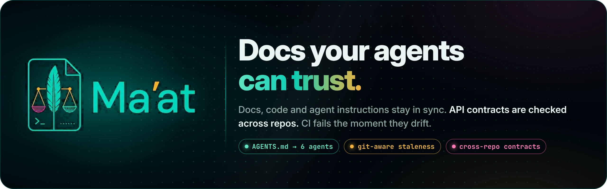

<p align="center">
  
</p>

<p align="center">
  <strong>Documentation-as-code for humans and AI agents.</strong>
</p>

<p align="center">
  <a href="https://github.com/getmaat/maat/actions/workflows/maat.yml">
    
  </a>
  <a href="https://github.com/getmaat/maat/releases/latest">
    
  </a>
  <a href="LICENSE">
    
  </a>
  <a href="https://github.com/getmaat/maat">
    
  </a>
</p>

---

## What it catches


One pull request changes the token lifetime in code but not in the docs. Another refreshes the contracts lockfile, which pulls in a new major version of an event the repository consumes. `maat check` in CI:

```text
✖ [contract_version] docs/architecture/modules/auth.md: consumes 'acme/ledger#ledger-events' '~> 1.6', but acme/ledger provides version 2.0.0
⚠ [staleness] docs/architecture/modules/auth.md: code internal/auth/token.go changed after this doc was last updated — review the doc and update it in the same change

Checked 14 document(s): 1 error(s), 1 warning(s).
```

Without this, the next agent session would read "tokens expire after 15 minutes" and build on it. More and more code is written by agents that trust the repository's docs, which makes stale docs a correctness problem, not a cosmetic one.

---

## Fast start

```bash
# Install (pick one)
brew install getmaat/tap/maat
curl -sSf https://raw.githubusercontent.com/getmaat/maat/main/scripts/install.sh | sh
go install github.com/getmaat/maat@latest

# Scaffold your repository, then validate it
maat init . --name "My Project" --summary "What it does"
maat check
```

`maat init` is safe to re-run and never overwrites files you already have. If your repository already has an `AGENTS.md`, Ma'at keeps your prose and adds its maintenance rules in a clearly marked managed block.

Run interactively, `init` also offers to add a "docs checked by maat" badge to your README; otherwise it prints the line to paste:

```markdown
[](https://github.com/getmaat/maat)
```

---

## What Ma'at does

### 1. One source of truth for every agent

Keep `AGENTS.md` and `docs/` canonical. `maat sync` generates what each tool expects:

`CLAUDE.md` · `GEMINI.md` · `.hermes.md` · `.github/copilot-instructions.md` · `.cursor/rules/maat.mdc` · `.windsurf/rules/maat.md`

plus `docs/llms.txt`, a machine-readable index of every doc. Codex, opencode and other tools that read `AGENTS.md` directly use it as is. `maat check` fails when a generated file falls behind its source.

### 2. Docs that can't silently rot

Each doc declares the code it describes:

```yaml
---
title: Auth tokens
status: current
summary: How access tokens are issued and how long they live.
related_code:
  - internal/auth/token.go
---
```

When a later commit changes that code but not the doc, `check` flags the doc. Staleness is judged from **git history**, so it works in CI and ignores timestamp noise from formatters, checkouts and rebases. The rule every contributor, human or agent, follows: *a change is not complete until its docs are updated in the same pull request.*

### 3. Contracts across repositories

Real systems span repositories. A doc can declare the interfaces it **provides** and the ones it **consumes**:

```yaml
provides:
  - id: invoice-api
    kind: http-api
    version: 2.1.0
    spec: api/openapi.yaml          # a spec change marks this doc stale
consumes:
  - ref: acme/ledger#ledger-events  # another repository's contract
    version: "~> 1.4"
```

- Every repository publishes its edges as **`.maat/manifest.json`**, and lists them in `llms.txt` so agents see the interfaces up front.
- A consumer names where providers live (`contracts.sources` in `.maat.yml`) and locks the contracts it uses:

  ```bash
  maat contracts update            # fetch consumed contracts into .maat/contracts.lock.json
  ```

- `maat check` validates cross-repo refs against that committed lockfile, **offline**: the same commit always gets the same verdict.
- A scheduled job checks whether providers have moved on:

  ```text
  $ maat contracts update --check
  .maat/contracts.lock.json is out of date:
    - acme/ledger#ledger-events: 1.6.0 → 2.0.0

  Run `maat contracts update` and commit the result.
  ```

  A breaking change arrives as a reviewable lockfile diff in the consumer, not as a mysterious red build on someone's unrelated pull request.

Details: [contract fields](docs/reference/frontmatter.md#provides-and-consumes) · [manifest](docs/reference/manifest.md) · [lockfile and sources](docs/reference/contracts-lock.md) · design in [ADR 0013](docs/decisions/0013-contract-edges-and-manifest.md) and [ADR 0014](docs/decisions/0014-cross-repo-contracts-via-lockfile.md)

---

## Wire it into CI

The pull-request gate, as a GitHub Action:

```yaml
name: maat
on:
  pull_request:
  push:
    branches: [main]
jobs:
  maat:
    runs-on: ubuntu-latest
    steps:
      - uses: actions/checkout@v4
        with:
          fetch-depth: 0   # full history, so staleness can compare commits
      - uses: getmaat/maat@v0.10.0
        with:
          version: "0.10.0"
```

Make the job required, and documentation drift blocks a merge like a failing test.

If your docs consume contracts from other repositories, add the scheduled freshness check. With the reusable workflow:

```yaml
on:
  schedule: [{cron: "17 6 * * *"}]
jobs:
  contracts:
    uses: getmaat/maat/.github/workflows/maat-check.yml@v0.10.0
    with:
      contracts_update_check: true   # runs `maat contracts update --check`
```

On any other CI, install the binary and run the same commands: `maat check` on every change, `maat contracts update --check` on a schedule. Tokens, private repositories and GitHub Enterprise: [deployment guide](docs/guides/deployment.md).

---

## How it works

```text
                         .maat.yml
                              │
                              ▼
   docs/*.md  ──scan──▶  DocsModel  ──┬── generate ──▶ llms.txt, agent adapters, index, manifest
  AGENTS.md                           │
                                      └── validate ──▶ pass/fail, the CI gate
                                              ▲
                     .maat/contracts.lock.json  (other repos' contracts, fetched on demand)
```

- **`docs/` and `AGENTS.md`** are the source of truth: hand-written, reviewed in pull requests, versioned with the code.
- **Everything else is generated** by `maat sync` and verified by `maat check`.
- **`check` and `sync` are offline and deterministic.** The network is touched only by `maat contracts update`; `git` is used for staleness when available.

| Command | Does |
| --- | --- |
| `maat init` | Scaffolds docs, `AGENTS.md`, config, CI workflow and agent adapters. Safe to re-run. |
| `maat sync` | Regenerates every derived file from the docs and `AGENTS.md`. |
| `maat check` | Validates front matter, links, `related_code`, staleness, contracts and drift. Offline. |
| `maat contracts update` | Fetches consumed repositories' contracts into the lockfile; `--check` only reports. |

A single static binary with no runtime dependencies. Full reference: [`docs/reference/cli.md`](docs/reference/cli.md).

<details>
<summary>What <code>maat init</code> scaffolds</summary>

```text
AGENTS.md                        # canonical cross-agent instructions
docs/
  index.md                       # human documentation entry point
  llms.txt                       # machine-readable documentation index
  architecture/
  decisions/                     # ADRs, with a template
  guides/
  reference/
  meta/
.maat/
  manifest.json                  # generated: contracts this repo provides and consumes
  skills/                        # generated agent skills (e.g. retrospect)
  templates/                     # module doc template
.maat.yml                        # configuration
.github/workflows/maat.yml       # CI gate

CLAUDE.md, GEMINI.md, .hermes.md, .github/copilot-instructions.md,
.cursor/rules/maat.mdc, .windsurf/rules/maat.md   # generated agent adapters
```

</details>

---

## Why not just…

**…an `AGENTS.md`?** Keep it: Ma'at builds on it. An instruction file alone has nothing that tells you when it, or the docs it points to, stopped matching the code. Ma'at adds the link to the code and the CI check.

**…a docs site generator?** Ma'at doesn't render websites. It keeps repository-local docs correct; publish them with whatever you like.

**…a service catalog like Backstage?** Catalogs describe services for humans, in their own files and infrastructure. Ma'at keeps contracts inside the docs that explain them, checks them in each repository's CI, and needs no server.

**…letting an LLM read the whole codebase each time?** Code says what the system does, not what it is supposed to do or why. Intent and decisions only exist if someone writes them down, and they're only useful if they stay true.

---

## Who is this for?

Ma'at is useful if your project:

- is worked on with AI coding agents such as Claude Code, GitHub Copilot, Codex, Cursor, Windsurf, Gemini CLI, opencode or Hermes;
- keeps docs in the repository, versioned with the code;
- wants one canonical source for contributor and agent instructions;
- wants CI to catch stale documentation;
- is split across several repositories whose APIs depend on each other.

More detail, question by question: [When to use Ma'at](docs/guides/use-cases.md).

**Status:** pre-1.0. Ma'at checks its own repository on every pull request. File formats carry a schema version (manifest and lockfile are both schema 1), and breaking changes are called out in the release notes.

---

## Documentation

This repository uses Ma'at on itself.

- When to use it: [`docs/guides/use-cases.md`](docs/guides/use-cases.md)
- Human entry point: [`docs/index.md`](docs/index.md)
- Agent entry point: [`docs/llms.txt`](docs/llms.txt)
- Design decisions: [`docs/decisions/`](docs/decisions/)
- Adopting Ma'at: [`docs/guides/deployment.md`](docs/guides/deployment.md)
- Contributor and agent protocol: [`AGENTS.md`](AGENTS.md)

---

## Contributing

Bug reports, feature requests and pull requests are welcome. Before opening a pull request:

```bash
go test ./...
go run . sync     # always the source build in this repository
go run . check
```

See [`CONTRIBUTING.md`](CONTRIBUTING.md) for development setup.

---

## License

Apache-2.0. See [`LICENSE`](LICENSE).

<sub>Ma'at is the ancient Egyptian concept of truth, balance and order.</sub>
